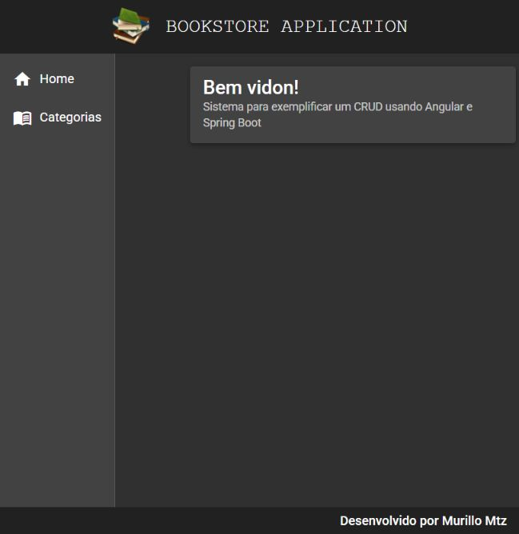
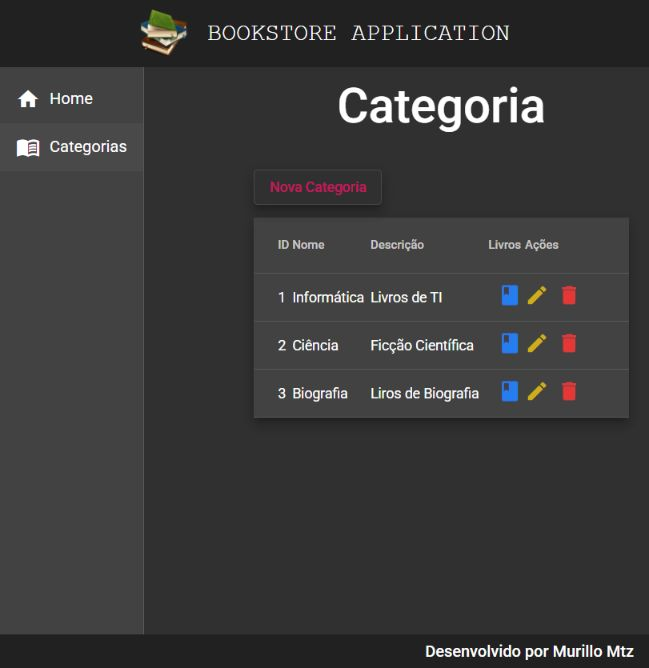
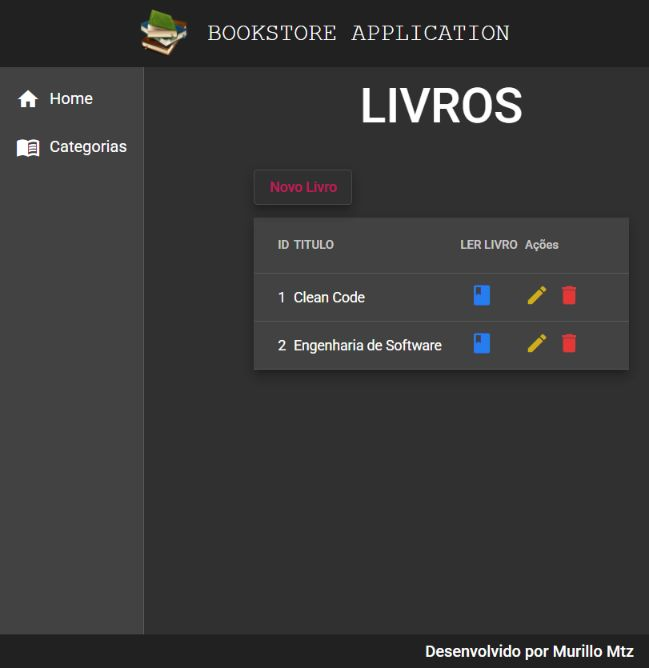

# Bookstore Gestão de Categorias e Livros

Interface web para organizar livros por categoria. O usuário consulta as categorias, abre os livros associados e utiliza telas próprias para criar, alterar, excluir e ler os registros mantidos pela API Bookstore.

**Categoria:** Frontend · Aplicação web.

## Tecnologias principais

- TypeScript
- Angular 11
- Angular Material 11

## Funcionalidades

- Página inicial com navegação lateral, cabeçalho e rodapé.
- Listagem e formulários de categorias.
- Consulta dos livros de uma categoria.
- Cadastro, edição e exclusão de livros.
- Página de leitura com os detalhes de um livro.

## Backend correspondente

Este projeto consome [Bookstore Backend](https://github.com/murillomtz/bookstore-back-end). Os serviços Angular consultam as rotas `/categorias` e `/livros`, incluindo o filtro de livros por categoria.

## Organização

`src/app/components/template/` reúne os elementos comuns da interface. `src/app/components/views/` contém as páginas e os serviços de categorias e livros. A navegação está definida em `src/app/app-routing.module.ts`.

## Executar

1. Inicie o backend Bookstore e confira sua porta.
2. Ajuste a URL da API nos arquivos `src/environments/environment.ts` e `environment.prod.ts`. A configuração original aponta para um endereço antigo no Heroku.
3. Use um ambiente compatível com Angular 11. Node.js 14 foi utilizado na execução das capturas.

```bash
npm install
npm start
```

Acesse `http://localhost:4200`. Para compilar a interface, use `npm run build`.

## Execução das capturas

O frontend foi compilado e conectado à API original, executada com o perfil `test` e H2. A URL da API foi alterada somente na cópia local para `http://localhost:8083/`.

As imagens mostram a página inicial, as categorias cadastradas pela massa de demonstração do backend e os livros de uma dessas categorias. Essa coleta confirma a leitura de dados; não representa uma verificação de todas as operações de cadastro e exclusão.

## Capturas do sistema

Capturas reais obtidas em execução local em 12/10/2026.

### Página inicial



### Categorias recebidas da API



### Livros da categoria



## Histórico

Repositório criado no GitHub em **2021-05-03**. Essa data identifica a criação do repositório; não comprova o início nem a conclusão do desenvolvimento.
